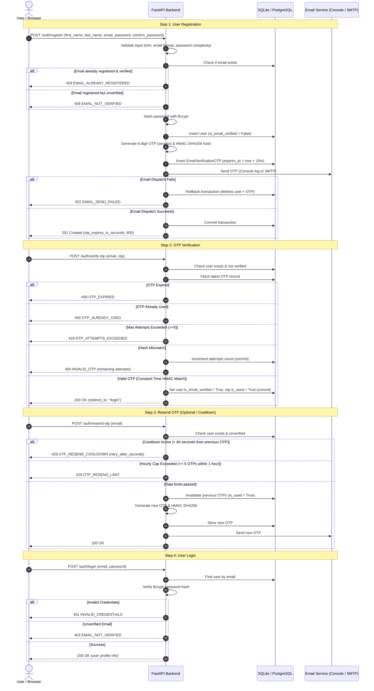

# EDABIP — User Registration & Email OTP Verification System

A secure, production-ready authentication and verification subsystem built for **EDABIP**. This module implements the complete user onboarding lifecycle: registration, validation, cryptographically secure OTP generation, constant-time verification, rate limiting, and credential authentication.

---

## 1. Flow Diagram



---

## 2. Tech Stack

- **Language & Runtime**: Python 3.11+ / Python 3.13
- **Framework**: [FastAPI](https://fastapi.tiangolo.com/) (Asynchronous ASGI REST API)
- **Validation**: [Pydantic v2](https://docs.pydantic.dev/) (Strict type parsing, custom regex & model validators)
- **Database ORM**: [SQLAlchemy 2.0](https://www.sqlalchemy.org/)
- **Security & Cryptography**:
  - Passwords: [Bcrypt](https://pypi.org/project/bcrypt/)
  - OTP Generation: Python `secrets` module
  - OTP Hashing: Constant-time `hmac.compare_digest` with HMAC-SHA256 & server secret
- **Email Backend**:
  - `console` (default for local development, logs OTP directly to terminal)
  - `smtp` (production ready with TLS & authentication)
- **Test Framework**: [pytest](https://pytest.org/) + `TestClient` (isolated in-memory SQLite database)

---

## 3. Project Structure

```
EDABIP/
├── app/
│   ├── __init__.py
│   ├── config.py              # Application settings via Pydantic BaseSettings (.env support)
│   ├── database.py            # SQLAlchemy engine, session maker, Base, init_db
│   ├── models.py              # User and EmailVerificationOTP SQLAlchemy models
│   ├── schemas.py             # Pydantic v2 request/response schemas with custom field validators
│   ├── security.py            # Password hashing (bcrypt) & OTP HMAC-SHA256 constant-time helpers
│   ├── errors.py              # Custom exceptions & uniform exception handlers
│   ├── email_service.py       # SMTP & Console fallback email service
│   ├── services/
│   │   ├── __init__.py
│   │   └── auth_service.py    # Core business logic isolated from route handlers
│   ├── routers/
│   │   ├── __init__.py
│   │   └── auth.py            # Thin FastAPI route handlers for /auth/*
│   ├── static/
│   │   ├── index.html         # Interactive demo UI (Signup -> OTP -> Login -> Profile)
│   │   ├── style.css          # Responsive styling with field error indicators
│   │   └── app.js             # Client logic connecting to /auth API endpoints
│   └── main.py                # FastAPI application entrypoint, lifespan, CORS, static mounts
├── tests/
│   ├── __init__.py
│   ├── conftest.py            # Isolated in-memory SQLite DB, client fixture, email service mock
│   └── test_auth.py           # Comprehensive pytest suite testing all 18+ scenarios
├── .env.example               # Template environment configuration
├── .gitignore                 # Secrets, virtualenv, databases, caches
├── requirements.txt           # Python dependencies
└── README.md                  # Complete architectural & operational guide
```

---

## 4. Database Schema & Relationships

### Table: `users`
| Column | Type | Constraints | Description |
|---|---|---|---|
| `id` | Integer | Primary Key, Auto-increment, Index | Unique user ID |
| `first_name` | String(100) | NOT NULL | User's first name (trimmed, max 100) |
| `last_name` | String(100) | NOT NULL | User's last name (trimmed, max 100) |
| `email` | String(255) | Unique, Index, NOT NULL | Normalized lowercase email |
| `password_hash` | String(255) | NOT NULL | One-way Bcrypt password hash |
| `is_email_verified` | Boolean | Default `False`, NOT NULL | Verification flag |
| `created_at` | DateTime | Default `datetime.utcnow`, NOT NULL | Record creation timestamp |
| `updated_at` | DateTime | Default `datetime.utcnow`, OnUpdate | Record update timestamp |

### Table: `email_verification_otps`
| Column | Type | Constraints | Description |
|---|---|---|---|
| `id` | Integer | Primary Key, Auto-increment, Index | Unique OTP record ID |
| `user_id` | Integer | Foreign Key (`users.id`), Index, NOT NULL | Owning user ID |
| `email` | String(255) | NOT NULL | Target email address |
| `otp_hash` | String(255) | NOT NULL | HMAC-SHA256 hash (never plain text) |
| `expires_at` | DateTime | NOT NULL | OTP expiration timestamp |
| `is_used` | Boolean | Default `False`, NOT NULL | Whether OTP has been redeemed |
| `used_at` | DateTime | Nullable | Timestamp when OTP was redeemed |
| `attempts` | Integer | Default `0`, NOT NULL | Number of failed attempts |
| `created_at` | DateTime | Default `datetime.utcnow`, NOT NULL | OTP dispatch timestamp |

**Relationship**: One `User` has many `EmailVerificationOTP` records (`cascade="all, delete-orphan"`). Only the latest unexpired, unused record is eligible for verification.

---

## 5. API Endpoints Specification

### Standard Response Envelopes
All responses follow consistent envelopes:
- **Success Envelope**:
  ```json
  {
    "success": true,
    "message": "Human readable confirmation message.",
    "data": { ... }
  }
  ```
- **Error Envelope**:
  ```json
  {
    "success": false,
    "error": {
      "code": "ERROR_CODE",
      "message": "Human readable explanation.",
      "field": "offending_field_name"
    }
  }
  ```

---

### Endpoint 1: Register Account
- **Method / URL**: `POST /auth/register`
- **Status Code**: `201 Created`
- **Request Body**:
  ```json
  {
    "first_name": "Bharath",
    "last_name": "Teja",
    "email": "bharath@example.com",
    "password": "Password123!",
    "confirm_password": "Password123!"
  }
  ```
- **Response `201 Created`**:
  ```json
  {
    "success": true,
    "message": "Account created. Please verify your email.",
    "data": {
      "email": "bharath@example.com",
      "verification_required": true,
      "otp_expires_in_seconds": 600
    }
  }
  ```
- **Error Responses**:
  - `400` with `FIRST_NAME_REQUIRED`, `LAST_NAME_REQUIRED`, `EMAIL_REQUIRED`, `INVALID_EMAIL`, `PASSWORD_REQUIRED`, `INVALID_PASSWORD`, `CONFIRM_PASSWORD_REQUIRED`, `PASSWORD_MISMATCH`
  - `409` with `EMAIL_ALREADY_REGISTERED` (if user exists and verified)
  - `409` with `EMAIL_NOT_VERIFIED` (if user exists and not yet verified)
  - `502` with `EMAIL_SEND_FAILED` (rolls back user and OTP if email delivery fails)

---

### Endpoint 2: Verify OTP
- **Method / URL**: `POST /auth/verify-otp`
- **Status Code**: `200 OK`
- **Request Body**:
  ```json
  {
    "email": "bharath@example.com",
    "otp": "482019"
  }
  ```
- **Response `200 OK`**:
  ```json
  {
    "success": true,
    "message": "Email verified successfully. Please log in.",
    "data": {
      "redirect_to": "/login"
    }
  }
  ```
- **Error Responses**:
  - `404` with `USER_NOT_FOUND`
  - `400` with `EMAIL_ALREADY_VERIFIED`
  - `404` with `OTP_NOT_FOUND`
  - `400` with `OTP_ALREADY_USED`
  - `400` with `OTP_EXPIRED`
  - `429` with `OTP_ATTEMPTS_EXCEEDED` (if attempts >= 5)
  - `400` with `INVALID_OTP` (increments attempts, reports remaining attempts)

---

### Endpoint 3: Resend OTP
- **Method / URL**: `POST /auth/resend-otp`
- **Status Code**: `200 OK`
- **Request Body**:
  ```json
  {
    "email": "bharath@example.com"
  }
  ```
- **Response `200 OK`**:
  ```json
  {
    "success": true,
    "message": "A new verification code has been sent to your email.",
    "data": {
      "email": "bharath@example.com",
      "otp_expires_in_seconds": 600
    }
  }
  ```
- **Error Responses**:
  - `404` with `USER_NOT_FOUND`
  - `400` with `EMAIL_ALREADY_VERIFIED`
  - `429` with `OTP_RESEND_COOLDOWN` (if requested within 60 seconds; includes `retry_after_seconds`)
  - `429` with `OTP_RESEND_LIMIT` (if requested >= 5 times within 1 hour)
  - `502` with `EMAIL_SEND_FAILED`

---

### Endpoint 4: Login
- **Method / URL**: `POST /auth/login`
- **Status Code**: `200 OK`
- **Request Body**:
  ```json
  {
    "email": "bharath@example.com",
    "password": "Password123!"
  }
  ```
- **Response `200 OK`**:
  ```json
  {
    "success": true,
    "message": "Login successful.",
    "data": {
      "user": {
        "id": 1,
        "first_name": "Bharath",
        "last_name": "Teja",
        "email": "bharath@example.com",
        "is_email_verified": true
      }
    }
  }
  ```
- **Error Responses**:
  - `401` with `INVALID_CREDENTIALS` (wrong email or password)
  - `403` with `EMAIL_NOT_VERIFIED` (credentials correct but user has not verified email)

---

## 6. Setup and Installation

### Prerequisites
- Python 3.10+ (tested on Python 3.13)
- `pip` package manager

### 1. Clone & Navigate to Project
```bash
git clone https://github.com/SugumarPerumal/Team-Assessments.git
cd Team-Assessments
```

### 2. Create and Activate Virtual Environment
```bash
# Windows
python -m venv venv
.\venv\Scripts\activate

# macOS / Linux
python3 -m venv venv
source venv/bin/activate
```

### 3. Install Dependencies
```bash
pip install -r requirements.txt
```

### 4. Configure Environment
Copy `.env.example` to `.env`:
```bash
# Windows
copy .env.example .env

# macOS / Linux
cp .env.example .env
```
*(By default, `EMAIL_BACKEND=console`, which prints OTPs directly to your console for testing without needing SMTP credentials).*

---

## 7. How to Run the Application

Start the FastAPI application with Uvicorn:
```bash
uvicorn app.main:app --reload --host 127.0.0.1 --port 8000
```

### Accessing the Interfaces
- **Interactive Web Demo Flow**: [http://127.0.0.1:8000/](http://127.0.0.1:8000/)
- **Interactive Swagger UI**: [http://127.0.0.1:8000/docs](http://127.0.0.1:8000/docs)
- **ReDoc Documentation**: [http://127.0.0.1:8000/redoc](http://127.0.0.1:8000/redoc)
- **Health Check**: [http://127.0.0.1:8000/api/health](http://127.0.0.1:8000/api/health)

---

## 8. End-to-End Testing Walkthrough (Demo)

### Option A: Using the Built-In Web UI
1. Open [http://127.0.0.1:8000/](http://127.0.0.1:8000/) in your browser.
2. Fill out the signup form (First Name, Last Name, Email, Password, Confirm Password) and click **Create Account**.
3. Look at your server terminal running `uvicorn`. You will see a banner like:
   ```
   ======================================================================
   [EMAIL - CONSOLE BACKEND]
   To: bharath@example.com
   Subject: EDABIP - Verify Your Email Address
   
   Hi Bharath,
   Your verification code is: >>> 482019 <<<
   This code will expire in 10 minutes.
   ======================================================================
   ```
4. Enter `482019` into the OTP screen and click **Verify Email**.
5. The screen automatically transitions to the Login page with your email prefilled.
6. Enter your password and click **Sign In**.
7. You are greeted by the verified user dashboard showing your User ID, Name, and Email!

### Option B: Using Swagger UI (`/docs`)
1. Go to [http://127.0.0.1:8000/docs](http://127.0.0.1:8000/docs).
2. Expand `POST /auth/register`, click **Try it out**, fill in user details, and click **Execute**.
3. Copy the OTP printed in your terminal.
4. Expand `POST /auth/verify-otp`, paste your email and the 6-digit OTP, and click **Execute**.
5. Expand `POST /auth/login`, submit your credentials, and observe the successful `200 OK` response with user data.

---

## 9. Running Automated Tests

Run the complete test suite using `pytest`:
```bash
pytest -v
```

All 16 test cases verify every assessment requirement including validation errors, password hashing, constant-time HMAC comparison, rate limits, cooldowns, invalidation, email failures with rollback, and login gating.
